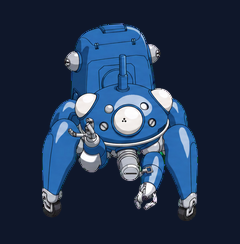

# Amplifier Unified Pocket Pet

**A pocket-sized voice companion for the work you already do in Amplifier Unified.** Tap the mic, ask your Unified chat a question, and hear the answer from the pet without opening your laptop.

[**Set up your first Pocket Pet**](docs/team-prototype.md#start-here) · [Download the LAN preview source](https://github.com/colombod/amplifier-unified-pocket-pet/releases/tag/v0.3.19-lan-preview.2) · [Report a problem or request a feature](https://github.com/colombod/amplifier-unified-pocket-pet/issues)

## How it works

1. **The pet** is a Waveshare ESP32-S3 board with a touchscreen, microphone, and speaker. Tap the mic to start a call over Wi-Fi.
2. **The Pocket gateway** runs on your Linux host. It uses OpenAI GPT-Live for voice and a paired companion credential to send requests to the Unified chat you selected during setup.
3. **Your existing Unified chat** does the work. The pet shows **Accepted** when Unified accepts a request, then speaks the reply when it comes back. Pocket is a companion, not a separate assistant or a replacement for Unified.

The LAN preview is usable with **one selected chat and one request at a time**. Wait for the spoken answer before asking another question; follow-ups are not queued, and progress reminders may repeat during long waits. **Mic Off** ends the audio, not work Unified already accepted. There is no background playback, remote mic reopening, off-home device access, or on-device workspace switching in this release.

## Install, deploy, and configure

**You’ll need:** a **Waveshare ESP32-S3-Touch-AMOLED-1.8 V2** (not the LCD-1.83 or earlier AMOLED version), a USB-C data cable, a phone, and a 2.4 GHz LAN. The gateway needs a Linux host with stock Amplifier Unified, a TLS certificate the pet trusts, and your own OpenAI API key with `gpt-live-1` access. The live voice path was verified with stock Unified `0.119.1`; run the guide’s compatibility check before pairing a different release.

| Step | What to do |
| --- | --- |
| **1. Get the release** | Download [the LAN preview](https://github.com/colombod/amplifier-unified-pocket-pet/releases/tag/v0.3.19-lan-preview.2). Use the same tagged source for the gateway and firmware. This is a source release, not a pre-flashed kit. |
| **2. Deploy the gateway** | [Set up the Linux service](bridge/deploy/README.md), [pair it with stock Unified](docs/team-prototype.md#2-prepare-unified-and-the-gateway), and select a chat. Verify the [TLS LAN listener](bridge/deploy/README.md#check-the-current-start) before making a paid call. |
| **3. Install the firmware** | Follow the [build, backup, and flash guide](docs/team-prototype.md#1-obtain-a-matched-build-and-preserve-the-board) for `unified_pet`, not the repository’s older root app. Use a spare board for the fresh-install steps; do not erase a provisioned pet or overwrite its saved settings. |
| **4. Configure the pet** | In **Settings → Phone setup**, scan the QR code. [Enter the gateway address, TLS name, and pet token, then save Wi-Fi](docs/team-prototype.md#3-configure-from-a-phone). Your Unified and OpenAI credentials stay on the host. |
| **5. Hear a reply** | Tap the mic, wait for **Listening**, and ask: **“Ask Unified what this chat is called.”** Wait for **Accepted** and the spoken answer, then check that the request landed once in the selected chat. See the [first-call checklist](docs/team-prototype.md#first-spoken-check) if it doesn’t. |

**Privacy and cost:** During a call, OpenAI processes microphone audio and the reply text used for speech. Voice and Unified model usage can incur charges. Check the actual chat for consequential details: spoken output is not guaranteed to be verbatim.

Real spoken replies have been verified on the maintainer’s provisioned board. A separate fresh-board and fresh-host install has not yet been verified end to end. See the [delivery brief](PROJECT-BRIEF.md#delivery-sequence) for evidence and the [issue tracker](https://github.com/colombod/amplifier-unified-pocket-pet/issues) for future work.
