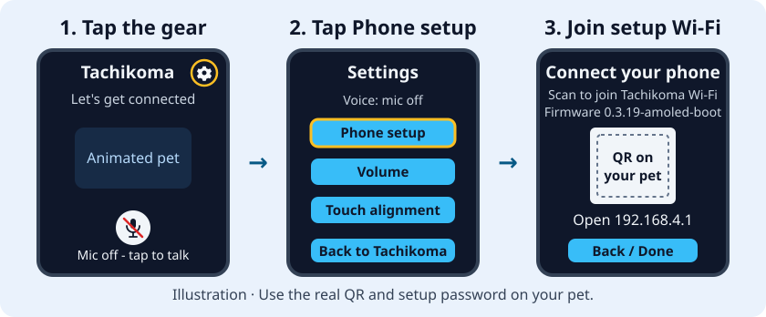
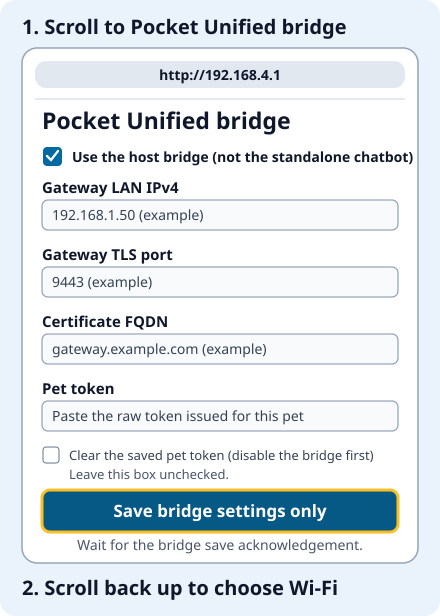
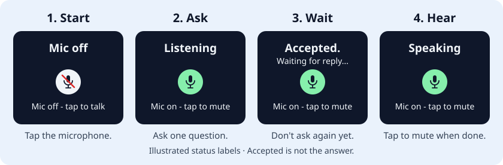

# Pocket assistant: teammate LAN preview setup

The current source uses the **Amplifier Assistant** name and the owner-supplied
Amplifier mascot. The published `v0.3.19-lan-preview.3` still has its original
artwork/name. Illustrations below describe the current source, not a new
installed or physically qualified release.

**What you'll get:** talk to one selected Amplifier Unified chat from the pet on
the same LAN as its gateway. Wait for each answer before speaking again. The
pet shows **Accepted** when Unified accepts the request. The gateway may speak
once while sending a slow request and once while waiting for its reply. It
doesn't repeat the same update. Nothing you say during the wait is queued. **Mic Off** ends
audio, not accepted work; there is no background playback or automatic mic reopening.
This source preview requires a local firmware build and is not yet a proven
turnkey install on a second person's hardware.

## Start here

1. **Get the correct board.** Order the **Waveshare ESP32-S3-Touch-AMOLED-1.8 V2**
   (CO5300/CST820, 16 MB flash, 8 MB PSRAM, ES8311 audio), not the LCD-1.83 or the
   earlier AMOLED revision. Use a USB-C data cable.
2. **Get one release.** Use the same tag for the gateway, firmware source, and
   release notes. The current published [LAN preview (`v0.3.19-lan-preview.3`)](https://github.com/colombod/amplifier-unified-pocket-pet/releases/tag/v0.3.19-lan-preview.3)
   is source-only; it does not include a firmware installer. Check the
   [host, account, Wi-Fi and TLS requirements](#what-to-get) before you write anything.
3. **Prepare your gateway.** Use [the Linux service guide](../bridge/deploy/README.md)
   for its Python environment, then [pair and bind](#2-prepare-unified-and-the-gateway)
   it to your own dedicated Unified chat. Start and verify the gateway using
   [the service checks](../bridge/deploy/README.md#check-the-current-start). Stop if the free
   compatibility or listener check fails; don't diagnose this with paid calls.
4. **Install Pocket Pet firmware.** Follow [the build instructions](#1-obtain-a-matched-build-and-preserve-the-board).
   Use [first install](#first-install-on-a-new-board) on an unprovisioned board
   and [app-only update guidance](#update-a-pet-thats-already-set-up) on a pet with
   saved settings. Both start with checking the board and preserving a backup
   before any write.
5. **Provision by phone, then try one question.** The [illustrated setup](#3-configure-from-a-phone)
   shows where to enter the gateway address, TLS details, pet token and Wi-Fi
   password. Then use the [first-call checklist](#first-spoken-check). Your Unified
   and OpenAI credentials stay on the gateway host.

[Evidence and limits](../PROJECT-BRIEF.md#what-is-done-and-what-the-evidence-does-not-prove):
normal `0.3.19-amoled-boot` firmware has spoken real replies on a provisioned board.
A second operator has not yet completed the fresh-board and fresh-host journey.
Neither home-away roaming nor queueing is included.

The goal is a voice interface to the user's authorized work across Unified, not
another chatbot or a permanently limited single-project assistant. The current
prototype uses a dedicated Unified chat as its front door. Spoken requests reach
that chat through the gateway, and the pet speaks the correlated response. Its
actual capabilities are bounded by that Unified account's permissions.
Microphone audio is sent to OpenAI during a call; recognized requests can be sent
to the Unified chat. The returned answer text is sent to OpenAI for spoken
rendering, including any private workspace information the front door includes.
The provider's spoken rendering is not guaranteed verbatim: check the Unified
conversation for consequential details.

## What to get

**Before pairing:** on the Unified host, from the product checkout, run
`"$UNIFIED_PYTHON" -I -B bridge/tools/check_unified.py`, where `UNIFIED_PYTHON`
is the absolute path of the Python interpreter used by your Unified installation.
It recognizes the inspected packages (0.116.0, 0.117.0, 0.119.0 and 0.119.1).
Use an unmodified Unified release; never patch Unified to pass this check.
It asks the installed package's actual companion policy about
the gateway's attach, list, read and send request shapes, entirely
in memory. No token, board, service stop, provider call or real send is involved.
An unknown version is reported as unqualified, not as a broken installation.
A pass is not proof of pairing, a spoken reply or compatibility with another release.

**Host-only, free first check:** from this checkout on Linux, with Python,
`aiohttp` and `cryptography` installed, run
`python3 -B bridge/tools/test_pet_link_test_host.py -q`. It uses ephemeral
loopback TLS, disposable credentials and the checked-in firmware's start frame.
It never opens the pet, calls the provider or contacts Unified. For a physical
LAN test the [listener](../bridge/tools/pet_link_test_host.py) uses the same
checkout and admission rules: see `--help`. Select a quiet pet speaker (`--leg
none`) and an external known acoustic stimulus to check signal; `tone` is a
transport test, not a microphone test. A nonzero sample isn't recognized
speech. For a free audible mic-to-speaker check, choose `--leg echo
--output-seconds 4 --expiry-seconds 15`. Say a harmless short phrase as the
call opens. The pet speaker stays quiet for the first four seconds, then
plays back that same input once. This mode briefly holds up to four seconds of
audio in host RAM; it saves only counts, never audio. Mute normally. If the
words cannot be heard clearly, the acoustic check did not pass. If they can,
that proves local playback of captured speech, **not** provider recognition
or a Unified reply. Do not replace a serving gateway or start a device test
without arranging the window with its owner.

- A **Waveshare ESP32-S3-Touch-AMOLED-1.8 V2**, with CO5300 display and CST820
  touch. The tested board has 16 MB flash, 8 MB PSRAM and ES8311 audio. Do not
  substitute the LCD-1.83 board. See the [Waveshare product page](https://www.waveshare.com/esp32-s3-touch-amoled-1.8.htm)
  and [board documentation](https://docs.waveshare.com/ESP32-S3-Touch-AMOLED-1.8);
  verify the V2 hardware revision with the seller before ordering.
- A USB-C data cable, a flashing computer and a phone with a browser.
- A 2.4 GHz personal Wi-Fi network and a Linux host running the user's own
  Amplifier Unified server. The demonstrated voice path uses the same LAN; away
  access over Tailscale is still a product goal, not a qualified setup.
- An OpenAI API key with access to `gpt-live-1` and billing enabled for the
  gateway. Unified itself needs its normal model configuration. The gateway's
  default voice is `marin`; do not assume another model is protocol-compatible.
- A certificate chain trusted by the firmware's ESP-IDF certificate bundle, a
  matching private key and an FQDN for the gateway. For a LAN-only listener,
  one option is a publicly trusted certificate for a DNS name you control,
  issued with ACME DNS-01 validation. This does not require a public inbound
  port on the gateway. Use the issued leaf-plus-intermediates chain and the
  matching private key in the gateway configuration; give the phone that exact
  name and the gateway's separate LAN IPv4. Keep the key private and renew
  before expiry. Choose a CA present in the firmware bundle; a public certificate
  is not by itself proof that the board trusts it.

Each voice connection is paid provider usage, including time spent listening or
waiting; Unified model usage is separate. There is no gateway daily spending cap.
The user chose automatic reconnect while the mic is on, and a reconnect can create
another paid connection. **The demonstrated build 11 does not yet provide that
reconnect behavior.**

## 1. Obtain a matched build and preserve the board

For this source preview, use the gateway and build Pocket Pet firmware from the
same tagged release source. The build produces `unified_pet.bin` and a flash manifest.
There is no prebuilt download yet. See the separate instructions below for a
first install or an update that preserves existing settings.

The build requires a reachable Docker daemon (`docker info`) and a locally
cached ESP-IDF 5.5.4 image with Pillow 11.3.0. Its explicit `--offline-cache` mode also requires
the matching component cache. The build deliberately
does not download an SDK or components during the build.

The public component cache can be prepared separately on Linux with Python 3,
`/proc/self/fd`, `renameat2`, and direct HTTPS access to
`components-file.espressif.com` (the downloader does not use proxy settings).
Pick an **absent** absolute destination under an existing immediate parent
directory that you own and that is not group- or world-writable; no path
component may be a symlink. From the repository root:

```sh
export PET_COMPONENT_CACHE="/absolute/path/to/new-component-cache"
python3 -B apps/unified-pet/scripts/prepare_components.py --prepare "$PET_COMPONENT_CACHE"
```

This opt-in command downloads exact locked versions, rejects unexpected content
and publishes only after all 13 complete component trees match the checked-in
pins. Fresh public downloads and the existing independent `offline_cache.py`
checker verified 4,523 files on the maintainer's Linux host. A clean
network-disabled firmware build also passed with that freshly prepared cache
and an **existing, separately prepared AMD64 tools image**. It did not validate
a fresh Dockerfile image build. If preparation fails after staging is created,
it retains that directory for inspection; an earlier failure may leave no stage.
It does not replace an existing cache. Keep the resulting cache in an
owner-controlled location and do not modify it during the build. A teammate's
complete fresh-machine setup is not yet verified.

The repository's `Dockerfile` pins the official ESP-IDF 5.5.4 multi-platform
image index and Pillow wheel hashes. On Linux AMD64, prepare the tools image
once from the same checkout, with access to Docker Hub and PyPI. From the
repository root, use a private context containing only the two listed files;
choose an unused local tag, and stop at any failed command:

```sh
PET_DEV_IMAGE=pocket-pet-tools:idf-v5.5.4-amd64
PET_TOOLS_CONTEXT=$(mktemp -d)
cp Dockerfile .dockerignore "$PET_TOOLS_CONTEXT/"
docker build --platform linux/amd64 --pull --no-cache \
  --tag "$PET_DEV_IMAGE" "$PET_TOOLS_CONTEXT"
```

On the maintainer's Linux AMD64 host, Docker resolved the pinned image index,
reused local base layers, and ran the architecture and Python checks and a
fresh, hash-checked Pillow install. This did not test an empty Docker base-image
store or ARM64.

Then use the new image and the `PET_COMPONENT_CACHE` exported above to run
the offline build from the same checkout:

```sh
PET_DEV_IMAGE="$PET_DEV_IMAGE" sh apps/unified-pet/scripts/build.sh --offline-cache
```

The build container has networking disabled; outputs and `flasher_args.json`
belong to `apps/unified-pet/build/`. Building is not installation or physical proof.
The build above also generates `apps/unified-pet/sdkconfig` from the tracked
`sdkconfig.defaults` on a clean clone. Run checks that read the generated file,
including the link rig and the historical isolation boundary check, **after**
the build. Do not copy an `sdkconfig` from a different checkout into a clean one.

### Custom artwork and name (source builds)

Customization is a source edit before building; there is no artwork picker or
rename menu on the pet or phone page.

- **Artwork:** replace `assets/source/amplifier-assistant.webp` with your own
  transparent **RGBA WebP**, exactly **1536 × 2288 pixels**. Use an 8-column,
  11-row v2 atlas of **192 × 208** cells. Left-to-right required frame counts
  per row are `6, 8, 8, 4, 5, 8, 6, 6, 6, 8, 8`: idle, running-right,
  running-left, waving, jumping, failed, waiting, running, review, and two
  eight-direction look rows. Unused cells may be transparent; every required
  cell must contain visible artwork. The exporter composites onto `#0f172a`
  and writes little-endian RGB565 without resizing the cells. Keep these row
  counts and offsets: the firmware already uses them. Idle is six frames at
  360 ms each; tapping the character plays four wave frames at 720 ms each.
- **Name:** in `apps/unified-pet/main/`, edit the visible **Amplifier Assistant**
  strings in `main.c`, `setup.html`, `network.c`, `assistant_config.h` and
  `live_voice.c`. Change the host-owned identity at the start of
  `_FRONTEND_INSTRUCTIONS` in `bridge/pet_bridge/gateway_provider.py` as well.
  `network.c` also uses the ASCII SSID prefix `Amplifier-Assistant`: its
  complete setup name, including the device suffix, must stay within **32
  bytes**. The default is `Amplifier-Assistant-XXXX-Setup`; the pet displays its
  exact name and password beside the QR. Keep a short name that fits the title
  beside the gear and the existing buttons. Change labels only, not mic
  callbacks, prompt policy, protocol identifiers or credential/NVS keys.
- Update `assets/source/amplifier-assistant.provenance.json` with your artwork's
  own source and hashes; don't retain the supplied mascot's provenance for
  replacement pixels. Use artwork you have the right to distribute. That
  record says only that the project owner supplied this particular asset for
  this project, not that other artwork or dependencies share a blanket license.
  Update the name/hash fixtures in `apps/unified-pet/tests/artwork_test.py`,
  `ui_contract_test.py`, `setup_page_test.mjs` and `bridge/tests/test_gateway_*.py`
  when deliberately customizing, along with the README thumbnail and setup
  illustration labels. Root `main/` is a legacy test target, not production;
  if retaining it, mirror its labels/prompts separately. Both exporters read
  the same source atlas; production never imports root `main/`.

Before the SDK build, use a Python with Pillow (the release tools pin 11.3.0)
for these host-only checks from the repository root:

```sh
python3 -B apps/unified-pet/scripts/export_pet.py
python3 -B apps/unified-pet/tests/artwork_test.py
python3 -B apps/unified-pet/tests/ui_contract_test.py
node apps/unified-pet/tests/setup_page_test.mjs
node apps/unified-pet/tests/setup_bridge_page_test.mjs
node apps/unified-pet/tests/setup_unified_page_test.mjs
```

The generated file is
`apps/unified-pet/assets/generated/amplifier-assistant.rgb565`; it contains
73 frames, 79,872 bytes each (5,830,656 bytes total). A successful host export is
not an SDK build, installation, or proof of the display or voice experience.
Then build the matched source using the instructions above, and follow the
appropriate authorized first-install or settings-preserving update path.

### First install on a new board

Use an unprovisioned V2 board. A first install writes the bootloader, partition
table (the map of flash storage), and app. Changing that map can make saved
settings unreadable even without erasing the chip. If the pet already has
settings you want to keep, use the update guidance below. Use the exact V2 board
and identify its USB serial port before opening it; opening serial can reset the
board. Close any serial monitor.
Use esptool 4.11.0 (from a local environment with pyserial 3.5 or the ESP-IDF
image if it reports the same version). Use stable power and stop on any error.

1. From `apps/unified-pet/build/`, inspect `flash_args` alongside
   `flasher_args.json`. For this target they must name the same three images
   and offsets below, with `dio`, `80m`, and `16MB`. Record the checksums of the
   three local build artifacts:

   ```sh
   sha256sum bootloader/bootloader.bin partition_table/partition-table.bin unified_pet.bin
   ```

2. In the same directory, set `PET_TOOLS_PYTHON` to your esptool environment's
   Python, `PET_PORT` to the identified port, and `PET_BACKUP` to a new absolute
   directory under a private parent outside Git. Before writing, require ESP32-S3
   with detected 16 MB flash and neither secure boot nor flash encryption. If the
   state is unclear, stop. Make and compare two independent full reads; keep the
   backup and checksums private. Do not share a dump or restore another board's
   flash. Run each block only if the preceding one succeeds.

   ```sh
   pet_flash() { "$PET_TOOLS_PYTHON" -B -m esptool --chip esp32s3 --port "$PET_PORT" "$@"; }
   pet_flash version
   pet_flash flash_id
   pet_flash get_security_info
   ```

   ```sh
   (umask 077 &&
     mkdir -m 700 "$PET_BACKUP" &&
     pet_flash read_flash 0x0 0x1000000 "$PET_BACKUP/factory.bin" &&
     pet_flash read_flash 0x0 0x1000000 "$PET_BACKUP/factory-check.bin" &&
     test "$(wc -c < "$PET_BACKUP/factory.bin")" -eq 16777216 &&
     cmp "$PET_BACKUP/factory.bin" "$PET_BACKUP/factory-check.bin" &&
     sha256sum "$PET_BACKUP/factory.bin" > "$PET_BACKUP/factory.sha256")
   ```

3. Only after the checked backup, write the matching build manifest (no
   `erase_flash` or `--force`), then verify the three offsets. If any step fails,
   stop and keep the dump. Use the vendor's recovery procedure for that same
   board; don't use a full-image restore as an app update.

   ```sh
   pet_flash write_flash @flash_args &&
   pet_flash verify_flash 0x0 bootloader/bootloader.bin \
     0x8000 partition_table/partition-table.bin 0x10000 unified_pet.bin
   ```

4. Power the spare board off and back on. Require the pet display and working
   touch in **Settings → Phone setup** before entering any credentials. If the
   screen doesn't come up, stop rather than reflash or erase. This first-board
   procedure has not yet been qualified on a spare V2 in a physical test.

### Update a pet that’s already set up

An update should replace only the app and leave the bootloader, partition table,
and settings storage alone. The portable tool's write mode has not been
qualified on a physical board: **keep your current firmware and use the dry run
only**. Run [`update_app.py`](../apps/unified-pet/scripts/update_app.py) with a
local Linux Python environment with `esptool==4.11.0` and `pyserial==3.5`.
Use a firmware SHA-256 from an independently trusted, matched build. From the
repo root, with `PET_TOOLS_PYTHON`, `APP_IMAGE` and `APP_SHA256` set:

```sh
"$PET_TOOLS_PYTHON" -I -B apps/unified-pet/scripts/update_app.py \
  --image "$APP_IMAGE" --sha256 "$APP_SHA256"
```

This checks the image and reports the proposed app-sector range, **without
opening any serial port**. It cannot validate the connected board or guarantee
the new app will boot. The portable writer has been exercised with simulated
flash, **not physically qualified**; do not use it on a daily-use pet yet. It
does not install new boards. Never substitute `idf.py flash` on a provisioned
board.

For an explicitly authorized qualification on a spare provisioned board, use
the exact V2 model, stable power, an idle gateway and a muted pet. Close all
serial monitors first; exclusivity does not evict an already open monitor. See
`--help` for `--apply`, the explicit port and expected station MAC, previous app
SHA-256 and a new backup directory under a private 0700 parent outside Git.
Opening the port can reset the device. No sudo, custom esptool reset sequence,
firmware decryption, or settings migration is supported.

Keep `backup.json`, `before-partition.bin` and `previous-app.bin` private. The
former app image is for a separate, authorized downgrade **after a verified
update**; use its recorded hash and the current installed app's trusted hash.
It is not an automatic recovery for a torn write. If `write-intent` exists and
the outcome is uncertain (including interruption around `boot-intent`), do not
reset, retry or restore NVS. Preserve the files and inspect the outcome first.
Successful readback and unchanged flash checksums are pre-boot evidence, not
proof of a cold boot, working audio, or successful teammate setup.

A generated `apps/unified-pet/sdkconfig` left by an earlier build takes
precedence over a changed `sdkconfig.defaults`. The build script now refuses an
image whose generated configuration lacks a checked-in setting; remove the stale
`sdkconfig` and `build/` directory and build again rather than bypassing it.

### Linux USB access for a serial or firmware operation

Only for an operation the device owner has authorized. First inspect the exact
device node **without opening the port**: its owner, group and mode, and your
effective group membership.

```sh
ls -l /dev/ttyACM0    # the actual node for this board; do not guess
id -nG                # groups of the current login session
```

A node owned `root:dialout` with mode `0660` is common; root ownership alone is
not a fault. Use approved least-privilege access: membership of the node's group
(effective only in a new login session) or a narrowly matched udev rule. Never
make the node world-writable and do not run the flashing tool as root to get
past permissions. Opening serial or JTAG can reset the device, so it needs the
same operation-specific authority as flashing. USB permissions, the source
tree's write policy and a Wi-Fi voice failure are separate problems; fixing one
says nothing about the others.

## 2. Prepare Unified and the gateway

Use your own Unified account and a dedicated private state directory, outside Git.
The host needs companion pairing, an existing chat in a registered workspace and the supported app actions used
by the front door. Unified 0.98.6 was inspected for the prototype; no minimum
supported version has been established. A second account's permissions and setup
have not yet been tested.

1. In Unified, create a **new dedicated workspace** and a chat called **Pocket
   assistant** in it, with `app_control` available. Pinning is optional. In its first
   message, ask it to save the block below unchanged as `AGENTS.md` at that
   workspace root. Approve the write through the normal host interface if asked;
   do not replace an existing file or reuse another project's instructions.
   Check that the chat reports the file saved, and use the normal file view to
   verify its contents. On the tested host, workspace-root `AGENTS.md` is loaded
   as instructions for chats in that workspace, including subsequent turns; it
   applies to every chat there, not only the front door. On another Unified
   version verify that mechanism rather than assuming the file will be loaded.
   In a later turn, ask the chat to summarize its instructions and identify the available
   `app_control` actions; if it cannot, stop and resolve configuration before
   pairing. That conversation is a configuration check, not proof that the model
   will always obey.

   ```text
   You are the user's Pocket assistant front door for authorized Amplifier Unified
   work. Messages can be transcribed speech; reply briefly and clearly for speech.
   Use available supported app_control actions to discover workspaces, conversations,
   status and waiting questions. Inspect action schemas before use and follow
   pagination. Do not invent endpoints, targets, permissions or results. If a
   target or instruction is ambiguous, ask a short clarifying question.

   Before sending to another conversation, answering a waiting question, creating
   a workspace or chat, or starting work, say the exact action and target and wait
   for a clear yes. If the action changes, ask again. A spoken yes is advisory and
   never substitutes for Unified's own approval, access or ownership requirements.
   Never impersonate human approval or bypass a refusal or Stop. Read-only discovery
   does not need that confirmation.

   For attention use supported get_state /attention/items and relevant session
   pointers. question actions are scoped to the calling chat; do not answer
   another chat's question directly. Read back the exact question, target and
   proposed answer. Ask for confirmation that repeats the answer in the next
   user message, such as "Yes, send my answer: no"; if unclear or changed,
   reconfirm. Call coordination.context for this front-door chat and take the
   current admitted humanInput.sourceMessageId and humanInput.sourceInputId.
   If either is missing or is not the current answer-bearing confirmation, stop;
   do not infer it from a prior message or peer text. With that genuine user
   input, use coordination.send to relay the owning chat, question ID, confirmed
   revision and prompt, exact answer and actual sourceMessageId. Inspect the
   send receipt: its admitted sourceInputIds must include that sourceInputId.
   If not, or if the outcome is uncertain, do not claim success or resend.
   The owner must re-read its question; if the
   confirmed snapshot changed, stop and reconfirm rather than answer the new
   version. Otherwise the owner uses its own question.answer with that revision,
   the actual user's sourceMessageId and the delivered sourceRequestId. The host
   captures sourceInputIds; coordination.send has no sourceMessageId argument.
   If the host does not provide and accept genuine human provenance, stop;
   never invent it.
   This handoff requires an eligible root conversation as the exact question
   owner. If the question belongs to a worker or the owner cannot receive the
   handoff, do not redirect it to a different owner or bypass the check; ask the
   user to open the relevant chat.
   Permission approvals are user-only and cannot be relayed as question answers.

   Distinguish accepted from completed, rejected and unknown; report what is
   actually observed. Workspace creation, chat creation and starting work are
   separate outcomes. For new work use workspace.prepare/create and then
   session.handoff.start in the actual workspace; check its receipt and later
   target output separately. Check the saved execution status for that handoff's
   exact inputId and its phase and evidence basis. If execution evidence is
   unavailable, say accepted or pending, not started. A finished generation
   alone does not prove the requested work succeeded. Inspect an uncertain result
   rather than repeating a send or mutation. Do not include credentials or
   private configuration in replies.
   ```

   These instructions depend on model compliance: **the gateway does not enforce
   the spoken yes**. For consequential actions, verify the target and use the
   applicable host approvals or act directly in Unified. The cross-chat question
   and new-work actions above reflect a source review of Unified 0.98.6, not a
   live cross-chat voice qualification. In particular, recognized speech reaching
   this chat has not been proven to provide the human provenance needed to answer
   a different chat's question. The pet token authenticates a device connection,
   not the person speaking. On the reviewed Unified 0.98.6 path, the host records
   gateway-submitted text as `ui` input; that classification is not independent
   proof of who spoke or that a confirmation was heard correctly. Until this
   voice handoff is verified for your setup, use Unified's normal interface to
   answer another chat's waiting question.
2. On the gateway host, choose a **new** absolute private directory outside Git,
   under an existing owner-controlled private parent. Do not use symlinks in
   the path or change permissions on someone else's existing directory. Keep the same
   `XDG_CONFIG_HOME` for pairing, attach, list and bind. In a local shell, change
   to this package's `bridge/` directory and use the Python environment from
   [service setup](../bridge/deploy/README.md). Use a new POSIX-compatible shell
   on Linux for these steps; `umask` and exported variables stay in this shell
   until you exit it. Replace the example paths and server origin with your own
   values. Stop at any failed command:

   ```sh
   umask 077
   export PET_PYTHON="/absolute/private/path/venv/bin/python"
   export XDG_CONFIG_HOME="/absolute/private/directory"
   mkdir -m 700 "$XDG_CONFIG_HOME"
   ```

   If `mkdir` failed, stop: do not continue with or change an existing directory.
   Once it succeeded, run:

   ```sh
   "$PET_PYTHON" -B -m pet_bridge pair-start --origin https://YOUR-UNIFIED-HOST:PORT --name pocket-assistant
   ```

   The Unified origin must pass hostname and system CA verification in the
   gateway's HTTPS child. The child has a deliberately stripped environment:
   a parent-shell or systemd `SSL_CERT_FILE` override is **not passed to it**.
   The child's Python/OpenSSL default trust store must trust the Unified server's
   certificate chain and the origin hostname must match. Use a Unified server
   certificate issued by a CA already trusted by that system Python/OpenSSL, or
   have its administrator install the organization's CA in that system trust
   store. Verify with the same Python and exact HTTPS origin before pairing.
   Never disable verification.
   Open the printed address in your signed-in Unified browser, compare the code
   on both screens, and approve only the matching request. Then run
   `"$PET_PYTHON" -B -m pet_bridge pair-poll` once. **A zero exit status alone is not
   approval:** if it prints `Not approved yet` or `Too early`, wait at least the
   displayed number of seconds and run the poll again. Proceed only when it
   prints `Approved. Credential reference:`; retain that reference privately for
   the config. A denied, revoked, expired or invalid request is not approval.
   Stop on an error or lost response, preserve the local state and inspect the
   outcome before deciding on recovery; do not assume approval or blindly start
   a new request.
   If a pairing start has an unknown result, stop and inspect it before recovery.
   `pair-abandon` forgets the local proof only; it does **not** cancel any server
   request, which may persist until expiry. Do not abandon or restart blindly.

   Next run `"$PET_PYTHON" -B -m pet_bridge attach`; proceed only on `Attached.`.
   Run `"$PET_PYTHON" -B -m pet_bridge list` and proceed only if it says `complete`.
   This lists visible root chats including idle, unpinned chats. To distinguish
   chats with similar names, list **only** the intended workspace:

   ```sh
   "$PET_PYTHON" -B -m pet_bridge list --all-work --workspace "/exact/workspace/on/the/Unified/host"
   ```

   The path is matched by Unified, not resolved on the gateway computer. It may
   appear in local shell history and host access logs. Listing does not rebind
   the gateway or change a running call. A title alone is not an identity.
   To verify the full ID in the **Pocket assistant** chat you created, ask:

   > Use `app_control` operation `get_state` with args
   > `{"path":"/selectedSessionId"}` and show me only the exact `value` returned
   > for this conversation. Do not select another chat or send any message.

   On the inspected host this caller-scoped read returned the calling chat's full
   ID; it does not enumerate other chats. It is an app tool call, not a terminal
   command. Check that the reply is the tool's actual value, not a guessed ID.
   The chat response and tool history contain this sensitive metadata. Copy it
   only to your own private configuration and terminal; shell history, process
   listings, scrollback or screen recording can expose it. Do not publish it.
   Verify the intended workspace and title in Unified, then compare the last
   eight characters of this exact full ID with the corresponding title in
   `list`. If it is absent, check the registered workspace and the exact chat
   on the same Unified host; pinning is not required. If the value is missing,
   identity uncertain, or the list incomplete, stop rather than guessing.
   The metadata read was verified on the inspected host for its calling chat;
   the teammate's model-mediated copy step remains untested.

   Replace `FULL-CHAT-ID` with the exact value and run:

   ```sh
   "$PET_PYTHON" -B -m pet_bridge bind FULL-CHAT-ID
   ```

   Proceed only on `Bound to session` with the expected short ID and title.
   Binding re-fetches the listing, requires the exact full ID in a complete list,
   and sends no chat message; it does not prove idleness. The resulting state
   root is `$XDG_CONFIG_HOME/amplifier-unified-pet-bridge`. Use
   `"$PET_PYTHON" -B -m pet_bridge --help` for the supported CLI. Pairing, native
   attachment, listing and exact-ID binding were also exercised on a separate
   disposable Unified 0.117.0 instance over verified HTTPS. This was automated
   host-side setup, not a human first installation or a conversation on the pet.
   If the shell closes after a confirmed step, start a new private shell in
   `bridge/`, restore `PET_PYTHON` and `XDG_CONFIG_HOME` to the **same** paths
   and continue from the last confirmed checkpoint. Do not rerun `mkdir`,
   `pair-start` or token generation simply to resume. If a checkpoint is unknown,
   preserve the state and investigate it before any new action.
3. Configure the gateway with the same state root, credential reference and full
   bound chat ID. Keep the restricted Unified credential and OpenAI provider key
   on the host. Create a **separate** random 32-byte pet token, encoded as
   unpadded base64url (43 characters), and configure only its SHA-256 hex digest
   over its ASCII text in `pet_token_sha256`. The raw token is needed privately
   for phone setup; it is not the OpenAI key or the Unified credential. Never put
   tokens in Git, chat, command arguments or a service unit. For a new device,
   the following Linux command creates an owner-only token file **once** in the
   same private directory from step 2, and prints only its hash for the config:

   ```sh
   "$PET_PYTHON" -B - <<'PY'
   import hashlib, os, secrets, stat, sys
   root = os.environ.get("XDG_CONFIG_HOME", "")
   try:
       parts = root.split("/")
       if not os.path.isabs(root) or any(part in (".", "..") for part in parts):
           raise ValueError("private absolute directory required")
       flags = os.O_RDONLY | os.O_DIRECTORY | os.O_NOFOLLOW
       dfd = os.open("/", flags)
       try:
           for part in filter(None, parts):
               nextfd = os.open(part, flags, dir_fd=dfd)
               os.close(dfd)
               dfd = nextfd
           info = os.fstat(dfd)
           if info.st_uid != os.geteuid() or stat.S_IMODE(info.st_mode) != 0o700:
               raise ValueError("owner-only directory required")
           token = secrets.token_urlsafe(32).encode("ascii")
           fd = os.open("pet-token.txt", os.O_WRONLY | os.O_CREAT | os.O_EXCL |
                        os.O_NOFOLLOW, 0o600, dir_fd=dfd)
           with os.fdopen(fd, "wb") as out:
               out.write(token + b"\n")
               out.flush()
               os.fsync(out.fileno())
           os.fsync(dfd)
       finally:
           os.close(dfd)
   except (OSError, ValueError):
       print("Token creation did not complete. Preserve the file and inspect privately.",
             file=sys.stderr)
       sys.exit(1)
   print("Token stored privately; SHA-256 of ASCII token, without newline:",
         hashlib.sha256(token).hexdigest())
   PY
   ```

   Proceed only on success and copy the printed digest into the private config;
   do not hash the trailing newline. For phone setup, on a trusted local host
   open the file in a private, non-recording viewer that makes no backups or
   cloud copies. With the phone in hand, type the 43 token characters (not the
   newline) into its masked setup field, taking care with each character. The
   field has no reveal control, so visual comparison after entry is unavailable.
   Do not paste the token into a shell, chat, command argument, shared clipboard or recorded
   terminal. Protect both screens from observers and close the viewer afterwards.
   If no such private transfer is available, stop and arrange one; this guide
   does not establish a secure remote transfer. If the command fails or the
   file already exists, it may be partial or its durability uncertain. Preserve
   it and inspect privately before deciding what to do; never overwrite it or
   generate a replacement blindly.
4. The gateway settings require its private state and credential paths, chat ID
   and label, LAN IPv4 and port, literal HTTP Host value, TLS certificate and key,
   pet token hash, and exactly one provider-key source. Use an owner-only 0600
   provider key file for a service. Settings, certificates, keys and state must be
   private, owner-controlled files/directories; final-component symlinks are
   rejected. Use absolute paths and an RFC1918 LAN address. The literal Host
   value must match the device's dial address and port; it is not the TLS
   certificate FQDN.

   **Recommended: a private `.env` file.** Machine-specific and secret values
   stay on your machine and out of the repository. Copy the tracked
   placeholder-only `bridge/.env.example` to a private owner-only `.env` in the
   same private directory from step 2, then replace every `<placeholder>`. From
   the `bridge/` directory, in the same private shell, create it with this
   command, not with `cp`, so that an existing filled-in file is never replaced:

   ```sh
   PET_ENV_EXAMPLE=".env.example"
   PET_ENV_FILE="$XDG_CONFIG_HOME/.env"
   if [ -e "$PET_ENV_FILE" ] || [ -L "$PET_ENV_FILE" ]; then
     echo "Stopped: the destination already exists. Nothing was copied or changed." >&2; false
   elif ( umask 077 && set -C && cat "$PET_ENV_EXAMPLE" > "$PET_ENV_FILE" ); then
     echo "Created a new private settings file."
   else
     echo "Stopped: the copy did not complete. No existing file was overwritten." >&2; false
   fi
   ```

   Proceed only on `Created a new private settings file.` The command creates
   the file only if nothing is at the destination. An existing file or symbolic
   link is left untouched and you see `Stopped: the destination already exists.
   Nothing was copied or changed.`; keep that file and edit it, or choose a
   different absent path. `Stopped: the copy did not complete. No existing file
   was overwritten.` means the shell could not create or fill a new file;
   inspect the destination before retrying. The new file is owner-only. The
   command assumes that directory is private and controlled only by you. It is a
   check followed by a redirect with the shell's no-overwrite option, not an
   atomic guarantee: something created at that path in between (for example a
   FIFO) could make it block or fail.

   Edit the copy in a private editor that makes no backups or cloud copies. Each
   variable has a one-line comment in the file. Values are literal: no quotes, no
   spaces around `=`, no inline comments. Never commit, paste or share the
   filled-in copy. The gateway is then started with
   `serve --env-file <absolute-path-of-that-file>`; it reads the file itself and
   refuses a file that is not a regular owner-only file, or any unknown,
   repeated, missing or malformed entry, with `error: config_invalid` before
   listening. The values pass the same checks as the JSON config. Do not edit
   the file while the gateway is starting: stop the service, edit, then start.
   The gateway refuses a file it sees change while reading it, but that is a
   before-and-after comparison, not a lock, and refusal of every concurrent
   edit is not claimed. Before you start the service, note the time with the
   two `date` commands that open the start step in
   [service setup](../bridge/deploy/README.md); a time taken after the start
   would make a healthy start look wrong. Afterwards do not rely on finding
   `gateway: listening on` somewhere in the journal, which also holds earlier
   runs: use the evidence tied to that start (the unit's `ActiveEnterTimestamp`,
   a `gateway_start` event-log record that is not older, and journal output
   restricted to the current invocation) as described under "Check the current
   start" in [service setup](../bridge/deploy/README.md), which also has the
   exact rules and the service unit. This path is offline-tested only; it has
   not been demonstrated on a running service or on a second machine.

   **Alternative: a private JSON config** with the same fields, started with
   `serve --config`. This is its shape; replace every value in angle brackets
   with your own:

   ```json
   {
     "version": 1,
     "state_root": "<absolute-XDG_CONFIG_HOME>/amplifier-unified-pet-bridge",
     "credential_ref": "<pair-poll-credential-reference>",
     "session_id": "<full-front-door-chat-id>",
     "session_label": "Pocket assistant",
     "bind_host": "<server-lan-ipv4>",
     "port": 9443,
     "host_header": "<server-lan-ipv4>:9443",
     "tls_cert_file": "<absolute-private-certificate-chain-path>",
     "tls_key_file": "<absolute-private-certificate-key-path>",
     "pet_token_sha256": ["<lowercase-sha256-of-pet-token-ascii>"],
     "model": "gpt-live-1",
     "voice": "marin",
     "provider_key_file": "<absolute-private-openai-key-path>"
   }
   ```

   `auth_root` may be omitted to use the state root's `auth` directory. Use only
   one of `provider_key_file` and `provider_key_env`, never both (in `.env`: only
   one of `POCKET_GATEWAY_PROVIDER_KEY_FILE` and `POCKET_GATEWAY_PROVIDER_KEY`). See
   `GatewayConfig` in `bridge/pet_bridge/gateway_state.py` and
   [service setup](../bridge/deploy/README.md). A complete clean-server config
   and installation walkthrough still needs maintainer validation. An optional
   source-level dual LAN/Tailnet listener is described in the service setup;
   it requires a matched device implementation and is not yet physically verified.

For the pet-to-gateway connection, the device dials the configured LAN IPv4 but
verifies the TLS certificate against a separately configured FQDN. The FQDN must
match the certificate, the actual firmware bundle must trust its chain, and the
pet needs working DNS/network time synchronization for a valid clock. The FQDN
must be lowercase, dotted and at most 63 characters; the gateway accepts ports
1024–65535. A private or self-signed CA is not automatically trusted. Do not
disable TLS verification to work around a missing certificate. A host-side TLS
test or unauthenticated `401` does not prove the firmware trusts this chain or
that a voice conversation works.

The gateway-to-OpenAI connection is a **third** TLS connection: it uses the
gateway process's Python/OpenSSL default trust configuration, distinct from both
the device bundle and the isolated Unified HTTPS child. Systemd may use a
different environment from a shell; OpenSSL CA overrides can affect this parent
process even though aiohttp proxy environment handling is disabled. Verify the
intended service trust configuration without printing credentials or weakening
TLS. These trust procedures are not yet qualified on a teammate's host.

## 3. Configure from a phone

This bridge-first sequence is supported by the current source but has not yet
been demonstrated on a factory-fresh teammate device:

### Open setup on the pet



*Illustration based on the firmware UI, not a photograph. It contains no usable QR or password.*

With the mic off, tap the gear at the top right and choose **Phone setup**. Scan
the QR on your pet and join its WPA2 setup network. If the page does not open,
stay on that network and open `http://192.168.4.1` in your phone browser.

### Save the gateway settings first



*Illustration of the bridge section, not a screenshot. The values shown are examples.*

Scroll down past the Wi-Fi form to **Pocket Unified bridge** and check
**Use the host bridge (not the standalone chatbot)**. Use the values from
[the gateway you just prepared](#2-prepare-unified-and-the-gateway):

| Field | What to enter |
| --- | --- |
| **Gateway LAN IPv4** | The gateway host's LAN address that the pet can reach, not the phone's address or a Tailscale address. |
| **Gateway TLS port** | The port of that gateway's verified TLS LAN listener (`9443` if you used the guide's example unchanged). |
| **Certificate FQDN** | The exact DNS name on the gateway TLS certificate, without `https://`, port, or path. |
| **Pet token** | The raw 43-character token issued for this pet, not its SHA-256 digest, the Unified credential, or the OpenAI key. For an already configured pet, leave blank to retain the saved token unless intentionally replacing it. Leave **Clear the saved pet token** unchecked. |

Tap **Save bridge settings only** and wait for **Bridge settings saved.** That
confirms the save, not that the gateway is reachable. If acknowledgement is
lost, reconnect to the setup page and inspect the nonsecret address settings.
A saved-token flag means only that **some** token is present. Keep the original
token; don't generate a new one to retry. If the prior outcome is still unclear,
stop and seek maintainer help rather than repeatedly saving.

### Join your home Wi-Fi

Scroll back up to **1 · Choose your Wi-Fi**, select your 2.4 GHz network, and
enter its password. The OpenAI key stays on the host in bridge mode. Tap
**Connect Amplifier Assistant**, wait for the save and connection result, then tap
**Done · return to my Wi-Fi**. If the phone disconnects before acknowledgement,
reconnect to setup Wi-Fi and inspect the result before trying again.

On the pet, verify **Connected** and **Host bridge configured** before the
[first spoken check](#first-spoken-check). These labels do not prove that the
first call will reach the gateway. Skip the historical **Tailscale** and
**Unified peer** setup sections for this LAN preview; do not run the diagnostic
Tailscale tunnel, which has a known shutdown race.

The setup page is HTTP inside the WPA2 setup network and uses a per-boot mutation
control; it is not HTTPS provisioning. The pet token is stored in device NVS.
Protect the phone session and flash dumps. The prototype is not a production
security qualification. Diagnostic serial logs can include network identities;
do not publish or share them without reviewing and redacting them.

## Offline checks for maintainers

These checks do not start a paid call, access the device or prove a fresh setup.
From the repository root, with the gateway Python environment described in the
[service instructions](../bridge/deploy/README.md), set `PET_PYTHON` to that
environment's Python executable as in the pairing steps above:

```sh
PYTHONDONTWRITEBYTECODE=1 "$PET_PYTHON" -B -m unittest discover -s bridge/tests -t bridge -q
node apps/unified-pet/tests/setup_page_test.mjs
node apps/unified-pet/tests/setup_bridge_page_test.mjs
node apps/unified-pet/tests/setup_unified_page_test.mjs
PYTHONDONTWRITEBYTECODE=1 "$PET_PYTHON" -B apps/unified-pet/tests/ui_contract_test.py
```

The link rig runs the production conversation owner and transport on the pinned
lwIP, TLS and WebSocket stack over a slow, lossy or briefly absent link; see
[apps/unified-pet/tests/link_rig/README.md](../apps/unified-pet/tests/link_rig/README.md)
for what it does and does not prove. It needs Docker with a tap device inside a
network-less container and the firmware's generated `sdkconfig`:

```sh
PET_DEV_IMAGE="YOUR-VERIFIED-LOCAL-IMAGE" PET_COMPONENT_CACHE="/absolute/cache" \
  sh apps/unified-pet/tests/link_rig/run_link_rig.sh \
  /absolute/fresh/output apps/unified-pet/sdkconfig all
```

The full bridge suite and these app setup/UI checks passed on the maintainer's
host for the prepared prototype. For native firmware and shared TLS checks, run
`apps/unified-pet/tests/run_native.sh` and `tests/run_shared.sh` inside the
pinned ESP-IDF 5.5.4 environment with `PET_TLS_HOST_LIB` pointing to the
appropriate real-host mbedTLS libraries; see `apps/unified-pet/AGENTS.md`.
Those SDK checks and a target build must be tied to the exact release source and
inputs. The historical isolation test requires its original private baseline;
even its standalone `test_project_boundary` needs the generated `sdkconfig`
from the build above. It is not a clean-clone acceptance test. A failed or unrun
check is not a pass.

## 4. Run and use the prototype

Start only one gateway against a given state and listener. The repository's
[fresh user-service installer](../bridge/deploy/README.md#install-and-start)
checks your configuration and generates the Linux user unit without hand-editing.
It does not start a listener or pair a device. Save the **absolute** path of the
gateway settings file and the gateway Python interpreter, then leave the
private pairing shell from step 2. Run the installer and `systemctl --user`
from a normal login shell with the user manager's own XDG settings, **not** the
private pairing `XDG_CONFIG_HOME`. Use the saved absolute paths for
`PET_ENV_FILE` and `PET_PYTHON`. The settings file's absolute `state_root` still
points at the private pairing directory; do not move the credentials.
Follow the start and verification steps after checking the dependencies and
certificate. Unified must remain available
separately. Systemd ordering is not proof that the network is ready. The service
was installed on the original host; its TLS listener returned the expected
unauthenticated `401`, and the user heard a real Unified reply through it. The
gateway journal matched the recognized input to the front-door chat. Same-host
restart handling and a second person's service setup remain unverified.
For a new host, follow the [current-start and LAN listener checks](../bridge/deploy/README.md#check-the-current-start)
before trying the device. The LAN check sends no bearer and makes no paid call.

### First spoken check



*Illustration of the status labels and mic control. **Accepted** is a receipt, not the spoken answer.*

1. On the pet, tap the round microphone once. Wait for **Listening** and say,
   “Ask Unified what this chat is called.” Use a chat-specific question: the
   voice model can answer general trivia without sending it to Unified.
2. Wait for **Accepted** and a spoken answer naming your dedicated chat. Check
   that the actual conversation contains one new request and its answer. A
   progress announcement is not the answer. If the answer never plays, check
   the conversation for the accepted request before asking again.
3. Tap the microphone again to mute when done. Muting ends audio, not work
   already accepted by Unified. If **Listening** never appears, recheck Wi-Fi,
   the gateway's current start, TLS and the saved token before another paid call.

Wait for each answer before speaking again. Speech during an outstanding
request or the answer is not queued, and barge-in is not yet qualified. For
consequential actions use Unified's normal confirmation and access controls.

An ordinary call ends after about 90 seconds of silence or at the ten-minute
limit. The demonstrated build 11 needs another tap after a lost connection,
once cleanup has settled. The newer source attempts bounded automatic
reconnection while the mic remains on; it is offline-tested, not installed or
physically demonstrated. Pair it with the gateway's pre-dial safeguard described
below, not an older gateway. Each new connection can incur provider charges.
Known terminal or uncertain endings do not authorize automatic replacement.
If it remains closing or cannot safely release the transport, seek maintainer
help instead of repeatedly retrying. The gateway can reconcile some lost
acknowledgements by exact input identity and hash; it never re-sends to find out.
If the outcome is unknown, inspect the conversation and preserve the journal
rather than repeating an action. A response arriving after the wait limit may
not be spoken.

On 16 November a call with build 11 gave one heard answer and then showed
**Microphone stream interrupted**: the pet's two-second microphone buffer filled
because its sends fell behind. The physical trigger is unknown. Offline, the same
voice code on the same network stack does this whenever the round trip to the
gateway passes about 60 ms during an answer; firmware `0.3.9-voice-link` raises
the TCP buffers that caused it and is built and offline-tested; that repair is
**not physically verified**.

On 19 November a physical test of `0.3.9-voice-link` was reported to show
**Reconnecting...** then **Listening** repeatedly while the user spoke. Offline,
2% packet loss from the pet does this: a microphone frame was given one second
to leave, one lost packet can hold the connection for longer, and the network
library then closes it. Firmware `0.3.10-send-wait` lets that frame wait for up
to 1.8 s while the microphone buffer has room, which keeps the call through a
0.6 s blackout. It is built and offline-tested, **not installed or physically
verified**, and whether packet loss caused the reported reconnecting is not
known. Sustained loss of a few percent, or a blackout of seconds, still ends a
call; with the mic on the pet then starts a new one, and microphone audio not
yet sent is discarded, never sent later.

### Voice scheduling and stalled links (`0.3.12-voice-steady`)

On-device bench comparisons identified two causes of self-ending calls: the
voice owner shared a core at the animated display's priority and fell behind,
and 1–5 s link stalls filled the two-second microphone FIFO. The owner now runs
on core 1 at priority 6. Conversations allow a microphone send up to 5 s,
wait up to 3 s for host-message queue room, and drop whole newest microphone
or reply-audio chunks when their buffers are full. Buffered microphone audio
is sent once in order, never replayed; dropped audio is a gap. A send stalled
longer than about 5 s still ends the call as a lost connection. One-turn mode
retains its earlier behavior. On the device, private bench builds without the
fix ended 7 of 37 calls themselves; with it, 44 calls (25-100 s each, against a
provider-free listener) ended only on mic off, including stalls of up to 2.7 s.
One normal `0.3.12-voice-steady` call returned a real Unified answer on
20 November, after about 95 seconds of silence, with choppy playback. That
is not conversational acceptance.

In `0.3.13-voice-clear`, both codec audio tasks run at priority 7 pinned to
core 0, while the voice owner remains at priority 6 on core 1.
On-device bench comparisons at priority 5/core 0 had holes in 7 of 8 calls
(10–15 s of each 25 s), codec writes up to 117 ms late against 60 ms of DMA,
and 95% microphone delivery; at priority 7/core 0, no codec write in 19 calls
was more than 28 ms late. Two of those calls still had brief gaps (0.14 s, and
three totalling 1.1 s) when reply audio arrived more than about 0.34 s late on
a weak Wi-Fi link (-73 to -81 dBm); the 320 ms playback prebuffer is unchanged.
The normal `0.3.13-voice-clear` build has not yet been qualified by a spoken call.

In `0.3.14-strong-ap`, each station join scans all channels and selects the
strongest access point of the saved network, rather than the first to answer;
a device scan found four at -42, -74, -80 and -84 dBm after earlier testing
had stayed on weak ones (-71 to -81 dBm).
On weak access points, 5 of 31 bench calls had playback gaps (worst reply-audio
arrival gap 1.4 s; earlier sends blocked for 1–5 s), while all 11 calls on the
-42 dBm access point had no playback gaps (worst arrival gap 205 ms, no send
blocked longer than 111 ms).
The pet still does not roam: it selects the strongest access point only when
it joins.
The normal `0.3.14-strong-ap` build has not been qualified by a spoken call.

The draft gateway no longer sends a request while the pet's audio is known to be
arriving late, catching up, or still queued toward the provider: it waits for the
stream to recover and for a fresh quiet period, so trailing words are not cut off
the request. The usual limit is six seconds of cumulative input wait. A single
long stall gets at most two extra seconds if input is arriving again and at
least a second of measured backlog has drained. That extension never authorizes
a send on its own: the input still has to catch up and settle. If it does not,
nothing is sent, the pet shows **Not sent** and the call ends; say it again in a new
call. This is an arrival-time estimate. It cannot prove that the provider has
finished transcribing, so check the Unified conversation for consequential
requests. With audio arriving on time it adds no delay.

In the current reconnect source, a confirmed certificate-verification failure
or an evidenced but inconclusive TLS failure prevents automatic replacement.
Ordinary connection loss remains eligible for bounded retry. If a failed
connection supplies no error evidence at all, it can still retry; this does
not establish that every permanent security or configuration failure can be
distinguished. Retries do not disable certificate verification. These checks
are offline evidence, not proof of TLS behavior on the installed device.

The draft gateway source checks for unresolved sends before opening a new paid
provider connection. When eligible, it may read up to four pages of the bound
conversation and record an exact, proven delivery before allowing a new call;
it does not resend the earlier input. Incomplete history, unavailable reads,
ambiguous proof or expired records remain blocked. The refusal uses a generic
policy close that can also indicate other causes. A proof read already in flight
may finish recording delivery after mute, but cannot restart that stopped call.
On the original host, the LAN service runs a version containing this safeguard
and handled the real call described in the [delivery brief](../PROJECT-BRIEF.md#delivery-sequence).
That call did not test the reconnect safeguard or setup on another host.

## Remaining acceptance work

- A matched package and a verified factory-board install, phone setup and first
  real conversation on a teammate's own server.
- Repeatable certificate provisioning, fresh-environment dependency installation
  and a verified complete setup on another host.
- Installed service surviving app restart; reconnect and mute without replay on
  the final device firmware.
- A real waiting question answered in the correct chat, and new workspace,
  chat and requested work actually started by voice.
- Real voice and context across Tailscale away from the home LAN, plus longer
  reliability, security and multi-device checks.

A passing build or a saved setup page is not evidence that these journeys work.
See [PROJECT-BRIEF.md](../PROJECT-BRIEF.md) for the whole-product delivery plan.
